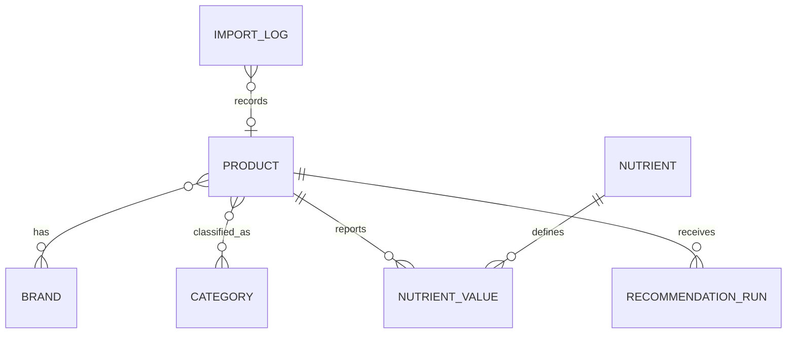

# LabelLens

LabelLens is a Django food-product discovery and nutrition information app. It searches Open Food Facts, stores products locally, preserves nutrient measurement bases and source provenance, and supports comparison and nutrient-specific alternatives.

## Features

- Responsive homepage, catalogue search, product details, comparison, dashboard and data transparency pages.
- Open Food Facts search and barcode lookup with bounded request timeouts, a custom User-Agent and short-lived response caching.
- Normalized MySQL-ready Django models for products, brands, categories, nutrients, source history and import results. SQLite is the default for easy local development.
- Nutrient values use decimal numbers and separate per 100 g, per 100 ml and per serving bases. Missing data remains missing. Declared serving calculations are marked as calculated.
- Side-by-side comparison and category-scoped, nutrient-specific alternative ranking. An optional scikit-learn TF-IDF model provides explainable product text similarity; ranking still works deterministically without it.
- Django authentication and protected Django Admin. Browsing stays public.

## Architecture

`catalog` owns product models, persistence, views, APIs, admin and validation. `integrations/openfoodfacts.py` isolates external HTTP behavior. `recommendations/ranking.py` handles alternatives and optional similarity. `config` contains Django settings, routes and WSGI setup. Templates, CSS and JavaScript live in `templates/` and `static/`.



Each imported record records Open Food Facts as its source, source URL, local retrieval timestamp and source modification timestamp when provided. Individual nutrient values retain their source, unit, basis, validation status and calculated flag.

## Windows setup (PowerShell)

Python 3.14 is supported by Django 5.2.8 and later. The included default configuration uses SQLite, so you can run the app without installing MySQL.

```powershell
python --version
py -3.14 -m venv .venv
.\.venv\Scripts\Activate.ps1
python -m pip install --upgrade pip
pip install -r requirements.txt
Copy-Item .env.example .env
python manage.py migrate
python manage.py seed_catalog
python manage.py createsuperuser
python manage.py runserver
```

Open http://127.0.0.1:8000. For an Open Food Facts lookup, set a descriptive `OFF_USER_AGENT` in `.env` in the requested `AppName/version (contact)` format. Search requests are rate limited by the provider; avoid rapid repeated searches.

### MySQL option

Install and start MySQL Server separately, then create a database with `utf8mb4` and a dedicated local user. Update `.env` with `DB_ENGINE=mysql`, `DB_NAME`, `DB_USER`, `DB_PASSWORD`, `DB_HOST`, and `DB_PORT`, then run `python manage.py migrate`. PyMySQL is used as the pure-Python MySQL driver. MySQL was not available in the implementation environment, so this option needs verification against your local server.

### Import and refresh products

Search the catalogue in the app, or import a barcode explicitly:

```powershell
python manage.py import_product 3017620422003
```

The command reports provider errors and does not create a success record when lookup fails.

To resume source-only nutrition enrichment for products that have no reported nutrition values, run a bounded batch:

```powershell
python manage.py enrich_catalog --limit 50 --min-completeness 100 --only-empty-nutrition --sleep 4.2
```

The command uses each product's barcode, preserves existing values, records a separate checkpoint for empty-nutrition products, and can be rerun to continue. It never fills gaps with estimated or generic food values. The `--dry-run` flag previews a batch without changing products or checkpoints.

## APIs

- `GET /api/products/?q=...&page=1` — local catalogue search, with external text search when `q` is present.
- `GET /api/products/{barcode}/` — stored or live barcode lookup.
- `GET /api/compare/?codes={barcode},{barcode}` — products and same-basis comparable nutrient sets.
- `GET /api/products/{barcode}/alternatives/?priority=lower_sugar` — supported priorities: `lower_sugar`, `lower_salt`, `lower_sat_fat`, `higher_protein`, `higher_fiber`.

## Data and recommendations

Open Food Facts provides community-contributed data; completeness and correctness are not guaranteed. The app does not invent product or nutrition details, does not equate absent allergens with allergen-free, and does not treat missing nutrient values as zero. Serving quantities are parsed from the declared text and calculations are labeled.

Alternative ranking requires a product category and a source nutrient value on a comparable basis. It filters candidates to the same category and nutrient basis. The ranking compares one priority at a time and does not imply an overall health judgment. If scikit-learn is installed, TF-IDF similarity over product name, brand and category is included as a tie-break relevance signal; otherwise the deterministic nutrient ranking is used. This is a lightweight similarity feature, not a clinically validated model.

To fit the optional TF-IDF text corpus from locally saved products and write `ml/artifacts/product_tfidf.joblib`, run `python manage.py train_recommender`. New products or changed product names/categories can be included by running the command again. When the artifact is missing or stale, request-time TF-IDF fitting is used; if scikit-learn is unavailable, nutrient-only deterministic ranking remains available.

## Tests

Run the deterministic local suite (no external API calls):

```powershell
python manage.py test
```

Tests cover missing/invalid values, salt and sodium separation, measurement bases, duplicate import handling, source refresh behavior, serving calculations, completeness, page behavior and API parsing.

## Administration and security

Use `python manage.py createsuperuser` to set up the first administrator. Do not use a shared or default password. Set a unique `DJANGO_SECRET_KEY`, `DJANGO_DEBUG=False`, and production `DJANGO_ALLOWED_HOSTS` before deployment. Keep `.env` private. Django's CSRF middleware, password hashing and ORM are enabled. The API has a basic anonymous request throttle.

## Deploy to Vercel

Vercel detects this Django project from the root `manage.py`, uses `config.wsgi.application`, and collects files from `STATIC_ROOT` for its CDN. The included `.python-version` selects Python 3.13. Django's SQLite database is for local development only; Vercel deployments require a persistent PostgreSQL database.

1. Create a private GitHub repository and import it into Vercel.
2. Add a PostgreSQL provider through Vercel Marketplace (for example Neon) and connect it to the project. Vercel provides `DATABASE_URL` to the deployment.
3. Set these Vercel environment variables for Production and Preview: `DJANGO_SECRET_KEY` (generate with `python -c "from django.core.management.utils import get_random_secret_key; print(get_random_secret_key())"`), `DJANGO_DEBUG=False`, and `OFF_USER_AGENT=LabelLens/1.0 (your contact email)`. Vercel supplies its deployment domains automatically; settings add those domains to Django's allowed hosts and CSRF trusted origins.
4. Link the local project with `vercel link`, then pull the configured environment with `vercel env pull .env.local`. Do not commit `.env.local`.
5. Initialize the database once: `python manage.py migrate --noinput` followed by `python manage.py seed_catalog`. The seed command loads the bundled source catalogue only when the database has no products. It includes 654 Open Food Facts records and source nutrition values; it never fabricates missing values.
6. Redeploy from Vercel. Later schema changes require `python manage.py migrate --noinput` against the linked database before the new app version is used.

The GitHub Actions workflow at `.github/workflows/checks.yml` runs Django checks, migration checks and the test suite on pushes and pull requests. Vercel's Django framework support, WSGI detection and automatic static-file collection are documented at [Deploy a Django app on Vercel](https://vercel.com/docs/frameworks/full-stack/django). PostgreSQL providers are connected through [Vercel Marketplace storage integrations](https://vercel.com/docs/marketplace-storage).

## Licensing and attribution

Product data is sourced from [Open Food Facts](https://world.openfoodfacts.org/). The database is under the Open Database License (ODbL), contents under the Database Contents License, and product images have separate licensing conditions. See [Open Food Facts terms](https://world.openfoodfacts.org/terms-of-use). LabelLens is not officially affiliated with Open Food Facts.

## Known limitations

- MySQL integration and live external access were not available for local verification.
- Open Food Facts legacy text search (`/cgi/search.pl`) is used because current v3 does not offer full-text search; barcode reads use current v3 product API.
- Local category and brand filters reflect imported records. Price, dietary certification, user history and personal consumption are not inferred or fabricated.
- The TF-IDF similarity component is optional and trained at request time on eligible local alternatives; no saved model artifact or accuracy claim is warranted for this unsupervised use.
- This application provides general product information, not medical or allergy safety advice.
